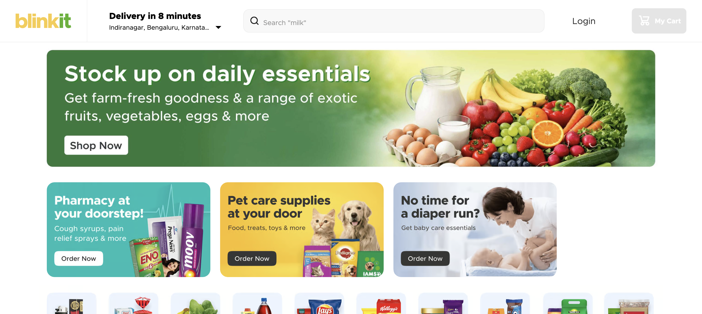
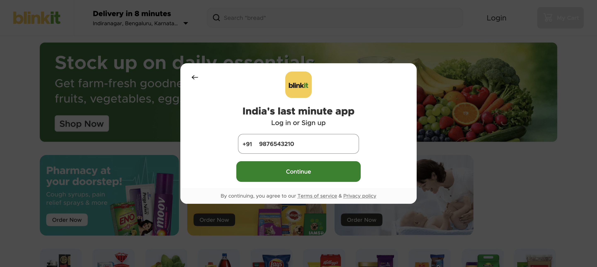
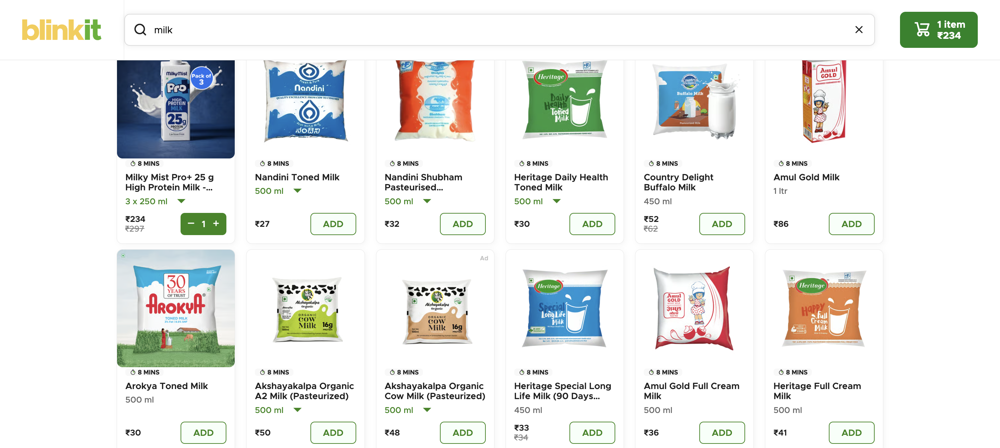
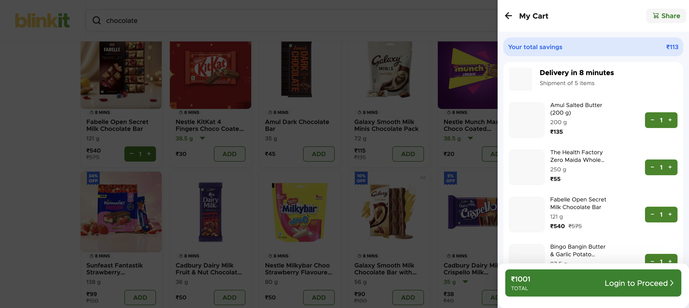
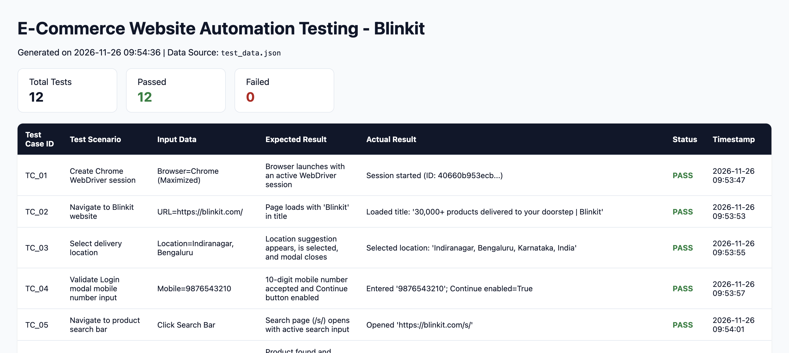

# 🛒 Blinkit E-Commerce Website Automation Testing

<p align="center">
  
  
  
  
</p>

## 📌 Project Overview

This project demonstrates **Data-Driven End-to-End Automation Testing** of the Blinkit e-commerce website using Python and Selenium WebDriver.

The automation script performs real browser interactions, including opening the Blinkit website, selecting a delivery location, validating the login interface, searching for products, adding products to the shopping cart, and verifying cart details.

All test inputs are maintained in an external JSON configuration file, making the automation flexible and reusable without modifying the Python source code.

## 🎯 Project Objectives

- Automate the Blinkit e-commerce website using Selenium.
- Perform automated browser interactions.
- Search and add multiple products to the shopping cart.
- Validate website elements and user interactions.
- Verify cart count and added products.
- Generate automated HTML and CSV test reports.
- Implement data-driven testing using JSON.

## ✨ Key Features

- **Browser Automation:** Automatically launches Google Chrome.
- **Website Navigation:** Opens the Blinkit website.
- **Location Selection:** Automatically selects the delivery location.
- **Login Validation:** Tests the mobile number input field.
- **Product Search:** Searches for five different products.
- **Add to Cart:** Automatically adds products to the shopping cart.
- **Cart Verification:** Checks cart count and product availability.
- **Automated Reporting:** Generates CSV and HTML test reports.
- **Data-Driven Testing:** Reads test inputs from `test_data.json`.

## 🛠️ Technologies Used

| Technology | Purpose |
|---|---|
| Python | Programming language |
| Selenium WebDriver | Browser automation |
| Google Chrome | Automated browser |
| JSON | External test data configuration |
| HTML | Test report generation |
| CSV | Test result storage |
| Python-PPTX | Presentation generation |

## 🔄 Project Workflow

1. Launch Google Chrome.
2. Open the Blinkit website.
3. Select the delivery location.
4. Open the login interface.
5. Enter the mobile number and validate the input.
6. Navigate to the product search page.
7. Search for products.
8. Automatically add products to the cart.
9. Verify the cart count.
10. Open the cart and verify all added products.
11. Generate CSV and HTML reports.
12. Close the browser automatically.

## 🧪 Automated Test Cases

The project contains 12 test cases.

| Test Case | Description | Status |
|---|---|---|
| TC_01 | Create Chrome WebDriver session | PASS |
| TC_02 | Navigate to Blinkit website | PASS |
| TC_03 | Select delivery location | PASS |
| TC_04 | Validate login mobile number input | PASS |
| TC_05 | Navigate to product search bar | PASS |
| TC_06 | Search and add milk | PASS |
| TC_07 | Search and add bread | PASS |
| TC_08 | Search and add butter | PASS |
| TC_09 | Search and add chips | PASS |
| TC_10 | Search and add chocolate | PASS |
| TC_11 | Verify all products in cart | PASS |
| TC_12 | Close browser session | PASS |

**Execution Summary:** 12 test cases passed and 0 failed in the documented execution.

## 📸 Project Screenshots

The following screenshots are available in the `screenshots/` directory.

### 1. Blinkit Home Page


### 2. Login Interface


### 3. Product Search and Add to Cart


### 4. Shopping Cart


### 5. HTML Test Report


## 📂 Project Structure

```text
blinkit-ecommerce-automation/
│
├── blinkit_automation.py
├── test_data.json
├── requirements.txt
│
├── TEST_CASES_DOCUMENTATION.md
├── test_results_report.csv
├── test_results_report.html
│
├── Blinkit_Automation_Testing_PPT.pptx
├── Blinkit_Automation_Project_Report.pdf
│
├── generate_ppt.py
├── generate_report.py
│
├── screenshots/
│   ├── 01_location_modal.png
│   ├── 01b_home_page.png
│   ├── 02_login_modal.png
│   ├── 03_search_add_to_cart.png
│   ├── 03b_search_bread.png
│   ├── 03c_search_butter.png
│   ├── 03d_search_chips.png
│   ├── 03e_search_chocolate.png
│   ├── 04_cart_drawer.png
│   ├── 05_html_report.png
│   ├── diag_architecture.png
│   ├── diag_cart_chart.png
│   └── diag_workflow.png
│
└── logos/
```

## ⚙️ Installation and Setup

### Step 1: Clone the Repository

```bash
git clone https://github.com/YOUR_USERNAME/blinkit-ecommerce-automation.git
```

### Step 2: Navigate to the Project Directory

```bash
cd blinkit-ecommerce-automation
```

### Step 3: Create a Virtual Environment (Recommended)

```bash
python3 -m venv venv
```

Activate the environment:

**macOS / Linux**
```bash
source venv/bin/activate
```

**Windows**
```bash
venv\Scripts\activate
```

### Step 4: Install Dependencies

```bash
pip install -r requirements.txt
```

### Step 5: Configure Test Data

Open `test_data.json` and update:

- Website URL
- Delivery location
- Test mobile number
- Product search keywords
- Timeout settings

Use your own test details and avoid committing personal information.

### Step 6: Run the Automation

```bash
python3 blinkit_automation.py
```

The script automatically launches Chrome and executes the configured test scenarios.

## 📊 Test Reports

After execution, the project generates two reports:

**1. CSV Report**

`test_results_report.csv`

Contains:
- Test case ID
- Test scenario
- Input data
- Expected result
- Actual result
- PASS / FAIL status
- Execution timestamp

**2. HTML Report**

`test_results_report.html`

Provides a formatted test execution summary with:
- Total test cases
- Passed test cases
- Failed test cases
- Detailed execution results

## 🚀 Future Enhancements

- Automate additional e-commerce test scenarios.
- Implement Page Object Model (POM).
- Add cross-browser testing.
- Integrate Pytest framework.
- Implement CI/CD using GitHub Actions.
- Add automated screenshots for failed test cases.
- Improve test reporting with Allure Reports.

## 🎓 Learning Outcomes

Through this project, I gained practical experience in:

- Python programming.
- Selenium WebDriver automation.
- Web element identification using XPath and CSS selectors.
- Explicit waits and expected conditions.
- Data-driven testing.
- Test case design and validation.
- Automated report generation.
- Real-world e-commerce testing workflows.

## 👨‍💻 Author

**Balakrishna Malage**

Engineering Student | Python | Software Testing | Automation

- GitHub: https://github.com/Balakrishna6669
- LinkedIn: www.linkedin.com/in/balakrishna-malage-33a30a276

---

<p align="center">
  ⭐ If you find this project interesting, consider giving it a star!
</p>

<p align="center">
  Built with ❤️ using Python and Selenium WebDriver.
</p>
